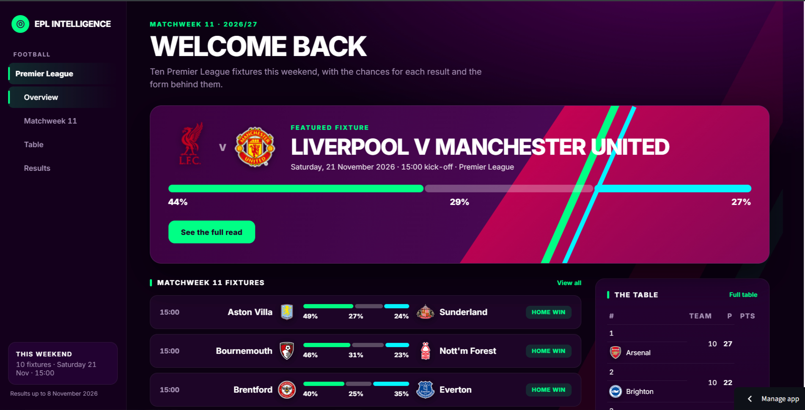
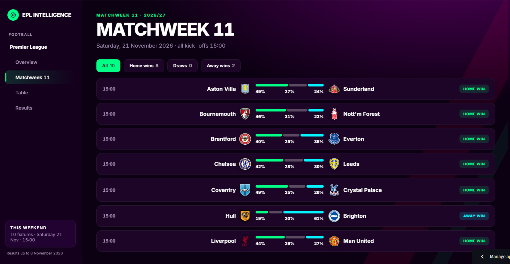
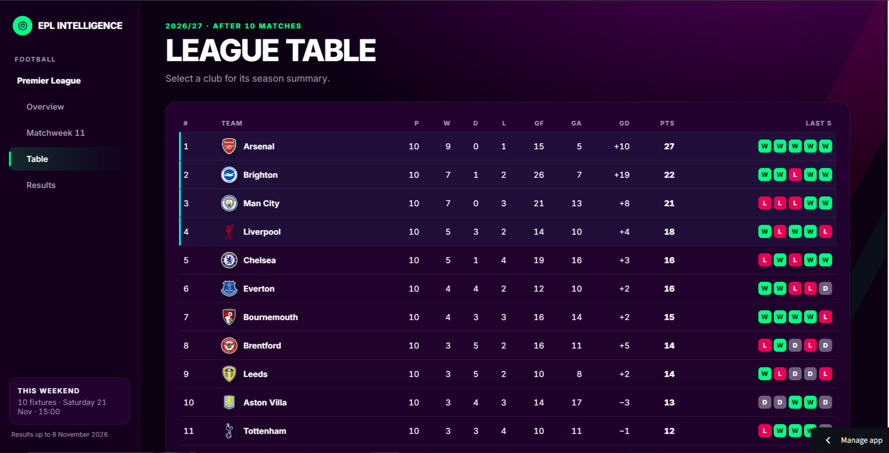
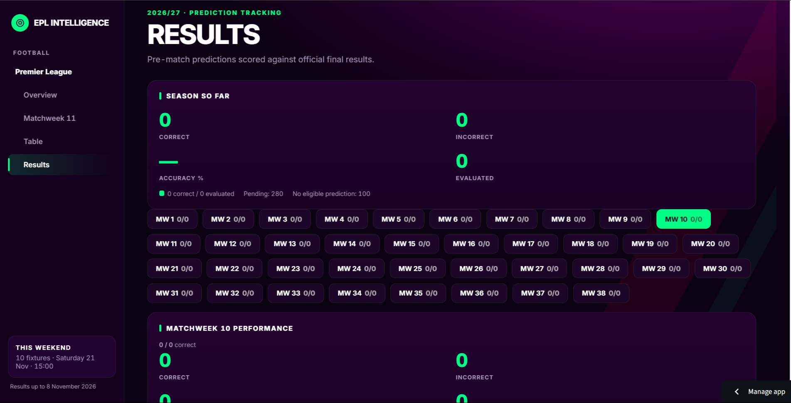
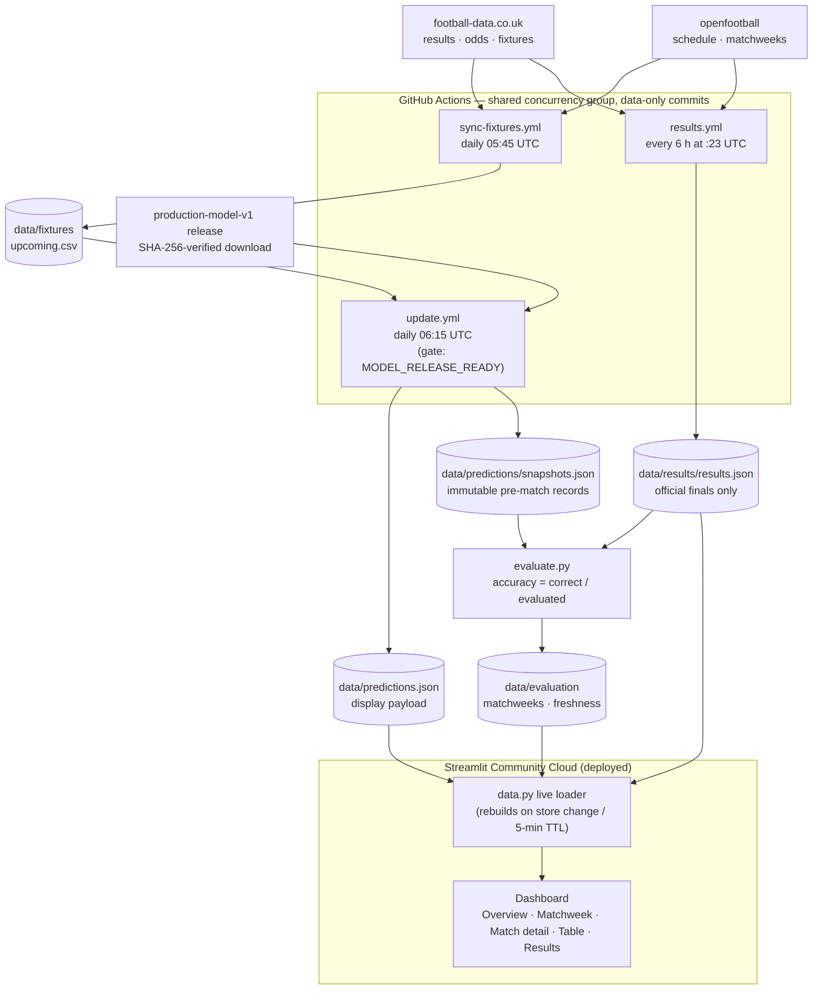

# EPL Intelligence

**A Premier League match-outcome prediction and football analytics platform — from live data synchronisation to a deployed, auto-updating dashboard.**

[](https://premier-league-prediction-engine-gwq3qyhfrdnpayf3xgsgvv.streamlit.app/)

<https://premier-league-prediction-engine-gwq3qyhfrdnpayf3xgsgvv.streamlit.app/> — free, public, no sign-in


**EPL Intelligence** predicts home-win / draw / away-win probabilities for upcoming Premier League fixtures, keeps immutable pre-match prediction snapshots, syncs official results, and evaluates every prediction against the real final score — all presented through a custom-built Streamlit dashboard that updates itself from GitHub Actions on a schedule.

[Overview](#-project-overview) · [Architecture](#-how-the-system-works) · [Methodology](#-prediction-model--methodology) · [Automation](#-automated-operations) · [Run locally](#-run-it-locally)

---

## 📷 Dashboard

| Overview | Fixtures & Predictions |
| :---: | :---: |
|  |  |
| *Overview — the main analytics dashboard: featured fixture with model probabilities, Matchweek 11 fixtures and current form.* | *Fixtures & Predictions — the dedicated Matchweek 11 page: all ten fixtures with model probability bars, filter chips (All · Home wins · Draws · Away wins) and predicted-outcome verdicts.* |
|  |  |
| *League Table — Premier League standings built from synced official results, with last-five form.* | *Results & Performance — pre-match predictions scored against official final results, per matchweek. Shown in its current early-season state: Matchweek 11 is the first predicted matchweek and has not yet been played, so 0 predictions have been evaluated — the tracker populates automatically as matches complete and results are synchronised.* |

---

## 🔖 Project overview

Football prediction projects usually stop at a model notebook. **EPL Intelligence is the full production loop**: it acquires 13 seasons of English Premier League data, engineers 237 pre-match features under strict leakage controls, serves probabilities from a calibrated ensemble model, records every prediction *before* the match is played, syncs official results after the final whistle, and publishes accuracy on the dashboard — updated daily without manual intervention.

### What it provides

- **Win–draw–win probabilities** for every upcoming fixture, produced by an approved production model (retraining disabled by policy; the artifact is SHA-256-pinned).
- **Immutable prediction snapshots** — the pre-match prediction is frozen at kick-off and never silently replaced, so later evaluation is honest by construction.
- **Official results synchronisation** with validation: conflicting or suspicious provider data is flagged, never guessed.
- **Evaluation with an honest accuracy formula** — `accuracy = correct / evaluated`; pending matches and missing predictions are never counted as wrong.
- **A deployed dashboard** with a custom dark match-centre UI: overview, matchweek view, match detail, league table, and per-matchweek prediction tracking.

### Who it is for

Recruiters and reviewers assessing end-to-end data engineering, football analytics enthusiasts who want transparent match probabilities, and developers looking for a reference implementation of scheduled, self-updating data products on GitHub Actions + Streamlit.

### What makes the engineering interesting

- **Leakage-first design** — proven by perturbation audits and dedicated tests, not just asserted.
- **Honest evaluation** — empty states are shown as empty (`—` accuracy, 0 evaluated), never as fake numbers.
- **Unattended operation** — three scheduled workflows with a shared concurrency group, atomic writes, idempotent stores and data-only commits.
- **Model governance** — a released, hash-verified production model with a readiness gate before any scheduled run.

---

## ⚙️ How the system works

1. **Collect** — public feeds (football-data.co.uk for results/odds/fixtures, openfootball for the season schedule and matchweeks) are downloaded by scheduled workflows. No credentials required.
2. **Prepare & validate** — the processing pipeline reconciles fixtures, scores and matchweeks; invalid or conflicting rows land in review lists instead of the stores.
3. **Predict** — the approved production model (downloaded from the `production-model-v1` release and verified against a pinned SHA-256) scores upcoming fixtures into home/draw/away probabilities.
4. **Snapshot** — each fixture's eligible pre-match prediction is frozen in an append-only snapshot store; after kick-off the record is locked.
5. **Sync results** — official final scores are stored only once the provider publishes them; a passing kick-off time is never treated as a result.
6. **Evaluate** — every final result is compared against the frozen snapshot; matchweek and season accuracy aggregates are rebuilt.
7. **Publish** — workflows commit data-only changes to the repository; Streamlit Community Cloud redeploys on push, and the dashboard's live loader (`data.py`) rebuilds its data object whenever a store changes.



*Every store is idempotent and written atomically; a workflow that finds no data change commits nothing. The `update.yml` job stays skipped until the repository variable `MODEL_RELEASE_READY` is `true`, and its model-download step hard-fails on any SHA-256 mismatch.*

---

## 📁 Project structure

```text
EPL-Intelligence/
├── app.py                     # Deployed dashboard entry point (query-param routing)
├── data.py                    # Live loader: builds the dashboard DATA object from stores
├── render.py                  # Renderers for overview / matchweek / match / table / results
├── static/                    # Approved prototype CSS/JS (styles, interactions)
├── src/
│   ├── pipeline.py            # Orchestration: refresh → validate → guarded retrain → predict
│   ├── config.py              # Paths, seasons, constants
│   ├── data/                  # Acquisition, fixture sync, processing, validation
│   ├── features/builder.py    # 237-feature pre-match feature engineering
│   ├── models/                # Ensemble, Dixon–Coles, training, evaluation
│   ├── prediction/            # Prediction engine + immutable snapshot store
│   ├── results/sync.py        # Official results synchronisation
│   ├── evaluation/evaluate.py # Accuracy aggregates + freshness reporting
│   └── research/              # Walk-forward, diagnostics, challenger experiments
├── data/                      # Production stores (committed, updated by workflows)
│   ├── fixtures/  predictions/  results/  evaluation/  processed/
├── artifacts/metadata/        # Model metadata (model artifact ships via GitHub Release)
├── reports/                   # Evaluation reports, leakage audit, research artefacts
├── tests/                     # Unit · leakage · prediction · integration suites
├── .github/workflows/         # sync-fixtures · update · results · test
└── docs/                      # Automation, acceptance and audit documentation
```

---

## 🎯 Prediction model & methodology

**Production model:** an ensemble of random forest + three LightGBM variants (`ensemble:random_forest+lgbm_regularised+lgbm_deep+lgbm_shallow`, version `epl-20261113-1478e7d5`), trained on 4,660 completed matches (2014/15 → 2026/27 up to the 8 Nov 2026 data cutoff) with 237 numeric pre-match features — 223 of them available without any market information. A no-odds variant serves fixtures whose prices are not yet published.

### Feature engineering

Elo ratings, rolling and venue form, season-to-date rates, rest/congestion, attack/defence strengths shrunk toward league priors, a Poisson goal expectation model, head-to-head records and market consensus features. Features are featurised *before* any state update with that date's results — verified by perturbation audits (flipping a result leaves its own feature row byte-identical) and enforced in the test suite.

### Calibration & decision rule

- **Temperature scaling** (T = 0.85) selected on a strictly chronological validation season (2023/24); vector scaling and a Dixon–Coles blend were evaluated and rejected by pre-registered gates.
- **Market blend** (`beta = 0.05`) chosen on validation log loss; the blend leans heavily on bookmaker consensus — reported openly rather than oversold.
- **Argmax decision rule** — the displayed pick is the highest-probability outcome; draws are never forced.
- Displayed percentages are rounded with the **largest-remainder method** so they always sum to exactly 100%.

### Evaluated performance *(held-out test results — clearly labelled)*

| Metric | Production | No-odds variant | Market consensus |
| --- | :---: | :---: | :---: |
| Accuracy | **51.84%** | 50.39% | 51.58% |
| Log loss | 0.9989 | 1.0232 | **0.9931** |
| Brier score | 0.5991 | 0.6126 | **0.5946** |
| ECE (10 bins) | 0.0640 | 0.0478 | **0.0321** |

*Methodology: 760 held-out matches from 2024/25–2025/26, scored once after all selection decisions were frozen; chronological splits only (train 2014/15–2022/23 · validation 2023/24 · test 2024/25–2025/26); 95% accuracy CI 48.29–55.38% (Wilson). Source: `reports/evaluation/FINAL_REPORT.md`, `artifacts/metadata/model_meta.json`, reproducible from `reports/evaluation/test_predictions.csv`. These are held-out test results, not live-season performance and not a guarantee of future accuracy. No in-season accuracy is advertised: the live Results page shows the honest running count as the season progresses.*

### Snapshots, leakage & evaluation

- Every fixture's first prediction is snapshotted; the **eligible** version is the latest one created before kick-off; post-kickoff regeneration never replaces evaluated values; probabilities are validated (each in [0, 1], sum = 1) before acceptance.
- Results sync stores only provider-published finals; discrepancies are flagged `needs_review`, and score corrections keep an audit trail.
- Evaluation always scores the frozen snapshot, never the regenerated display payload.

---

## 🤖 Automated operations

| Workflow | Schedule (UTC) | What it does | Status |
| --- | --- | --- | --- |
| `sync-fixtures.yml` | daily 05:45 + manual dispatch | Updates the upcoming-fixture store; commits only on change | ✅ Scheduled execution verified (run 43881467322, success — no commit as no fixtures changed) |
| `update.yml` | daily 06:15 + manual dispatch | Gated refresh: downloads the SHA-256-pinned production model, runs the prediction pipeline + leakage audit, commits data-only changes | 🟡 Scheduled run not yet verified (first gated run fired while the gate was still off). A manually dispatched run was verified end-to-end: model hash check → predictions (10 fixtures, retraining disabled) → data-only commit. |
| `results.yml` | every 6 h at :23 + manual dispatch | Syncs official results, evaluates frozen snapshots, rebuilds accuracy aggregates + freshness | ✅ Scheduled execution verified (3/3 recent scheduled runs successful; latest produced data-only commit `291adc6`) |
| `test.yml` | on push / pull request | Unit, leakage, prediction and integration test suites | ✅ Verified (latest push run successful) |

### Model governance & safety

- **Readiness gate:** `update.yml` runs only while `vars.MODEL_RELEASE_READY == 'true'`.
- **Integrity check:** the production model is downloaded from the `production-model-v1` release and verified against pinned SHA-256 `6824f537…bf0202`; any mismatch aborts the run.
- **Retraining policy:** disabled by default (`--retrain never`); a guard skips retraining unless ≥10 new matches exist and rejects any new model whose test accuracy regresses by more than 1 pp.
- **Commit hygiene:** all automated commits touch only `data/*` and `reports/*`; stores are atomic and idempotent; a shared concurrency group serialises the three data workflows.
- **Dashboard propagation:** Streamlit Community Cloud redeploys on every push, so a data commit becomes visible on the live site within minutes. Verified live: the dashboard's freshness panel matched the latest data commit's timestamp.

> **Status honesty:** the table separates *configured* behaviour from *independently verified* scheduled execution. Scheduled prediction runs are the one item not yet confirmed — the first gated scheduled run fired before the readiness gate was enabled; verification resumes with the next scheduled slot.

---

## 🛠 Technology stack


*Playwright (1.65) supports the visual regression/interaction test tooling; Pillow is used by image-diff checks. Versions come straight from `requirements.txt`.*

---

## 💻 Run it locally

**Requirements:** Python 3.12+ (developed on 3.14), pip. The dashboard runs out of the box from the committed data stores — no model download is needed to browse predictions, table, results and freshness.

```bash
git clone https://github.com/shafimughalp-creator/Premier-League-Prediction-Engine.git
cd Premier-League-Prediction-Engine
python -m venv .venv
.venv\Scripts\activate            # Windows   (Linux/macOS: source .venv/bin/activate)
python -m pip install -r requirements.txt
python -m streamlit run app.py
```

Open the URL Streamlit prints (usually `http://localhost:8501`). Navigate with the sidebar or the routes `?page=overview · week · table · results · match&id=…`.

**Optional — run the automation modules locally** (all safe to re-run; every store is idempotent):

```bash
python -m src.data.fixture_sync --fetch --json     # fixture sync against live feeds
python -m src.results.sync --fetch --json          # official results sync
python -m src.evaluation.evaluate --json           # evaluation + aggregates + freshness
python -m src.pipeline --offline --predict-only    # predictions from committed data (no network)
```

*Full pipeline refreshes with retraining require the production model artifact (`artifacts/models/model.pkl`, distributed via the `production-model-v1` GitHub Release and not stored in git). Tests: `python -m pytest -o addopts="-q"` (211 tests).*

---

## ⛰ Limitations & future work

### Current limitations (stated honestly)

- **Market dependence:** the selected blend weights bookmaker consensus heavily; paired testing showed no statistically significant edge over the closing market.
- **Draw recall is zero** under the argmax rule — draws receive probability mass but are never the predicted pick. A forced-draw policy was evaluated and rejected (failed replication across walk-forward origins).
- **No lineup, injury, referee or travel data** — no leakage-free reconstruction across 13 seasons is available from the chosen sources.
- **Scheduled prediction execution is not yet independently verified** (first gated slot fired before the readiness gate was enabled); all other schedules are verified.
- GitHub's cron scheduler can delay runs by minutes to hours; stores are idempotent so late runs remain correct, merely late.

### Planned improvements

- Walk-forward validation as the default selection protocol (already built as a research module; not the production selection method yet).
- Reliability/resolution decomposition to evaluate the market-blend decision on skill rather than log loss alone.
- New pre-match features (lineup strength, travel, referee tendencies) — each requiring a timestamp audit before adoption.
- Confirm scheduled prediction runs and publish a live season accuracy tracker on the Results page.

---

## 🔗 Links

- **Live dashboard:** <https://premier-league-prediction-engine-gwq3qyhfrdnpayf3xgsgvv.streamlit.app/>
- **Repository:** <https://github.com/shafimughalp-creator/Premier-League-Prediction-Engine>
- **Automation documentation:** [docs/automation.md](docs/automation.md) · **Full evaluation report:** [reports/evaluation/FINAL_REPORT.md](reports/evaluation/FINAL_REPORT.md) · **Project status:** [PROJECT_STATUS.md](PROJECT_STATUS.md)
